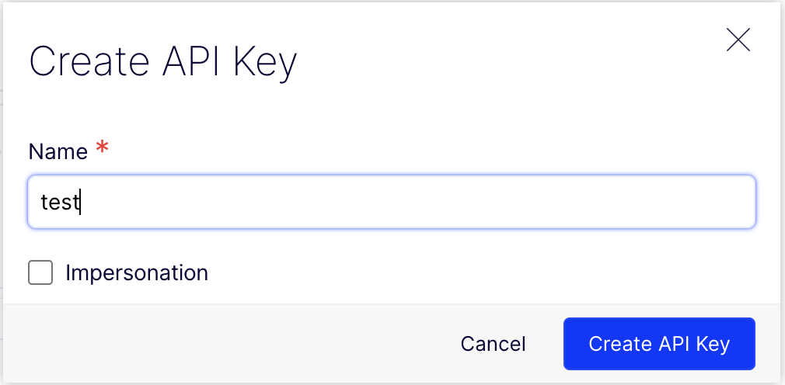
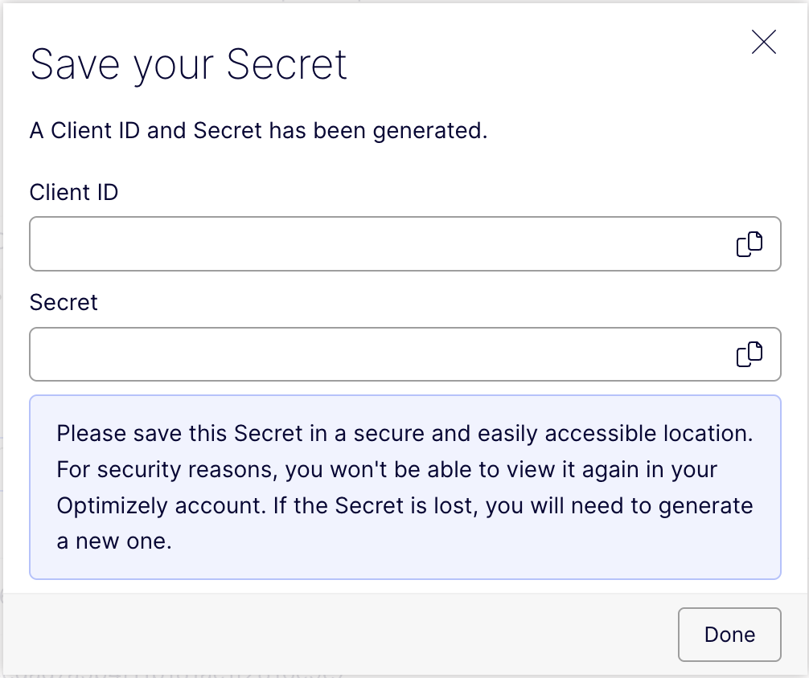

# Connect to the CMS

Before the CLI can upload content types to Optimizely CMS, it needs credentials for your
instance. On this page you create an API key, check that it works, and add the config file
the CLI reads.

> **You will learn**
>
> - How to create an API key in the CMS
> - How to store it in a `.env` file
> - How to check the connection
> - How to tell the CLI where your content types live

## Create an API key

1. In your CMS (`https://<your-instance>.cms.optimizely.com`), go to **Settings → API
   Keys** and click **Create API key**.
2. Give the key a name, such as the name of your project, and click **Create API key**.

   

3. Copy the **Client ID** and the **Client Secret**. The secret is shown only once.

   

## Store the key in `.env`

Create a file called `.env` in the root of your project and paste in the two values:

```ini
OPTIMIZELY_CMS_CLIENT_ID=<your client id>
OPTIMIZELY_CMS_CLIENT_SECRET=<your client secret>
```

The CLI reads `.env` from the directory you run it in, so always run it from the project
root.

> [!WARNING]
>
> The client secret gives full access to your CMS. Make sure `.env` is listed in your
> `.gitignore` before you commit anything. Projects created with `create-next-app` ignore
> it already.

## Check the connection

```sh
npx @optimizely/cms-cli@latest login
```

If the key is correct, the CLI prints **Your credentials are correct**. If it prints
**Authentication failed**, check that both values in `.env` are complete, with no
surrounding quotes or spaces.

## Tell the CLI where your content types live

Create `optimizely.config.mjs` in the root of your project:

```js
// optimizely.config.mjs
import { buildConfig } from '@optimizely/cms-sdk';

export default buildConfig({
  components: ['./src/components/**/*.tsx'],
});
```

`components` is a list of glob patterns. When you push, the CLI imports every matching
file and uploads the content types it finds. You will create the first one on the next
page, in `src/components/Article.tsx`.

The file supports more options, such as excluding files, property groups, locales and
applications. See [`optimizely.config.mjs`](../reference/optimizely-config.md) when you
need them.

> [!NOTE]
>
> The CLI talks to the production CMS API by default. To use another environment, set
> `OPTIMIZELY_CMS_API_URL` in `.env`. See
> [Environment variables](../reference/cli.md#environment-variables).

## Recap

- The CLI authenticates with a client ID and secret, created under **Settings → API
  Keys**.
- Store them in `.env` as `OPTIMIZELY_CMS_CLIENT_ID` and `OPTIMIZELY_CMS_CLIENT_SECRET`,
  and keep that file out of version control.
- `login` checks the credentials.
- `optimizely.config.mjs` tells the CLI which files define content types.

**Next:** [Your first content type →](./first-content-type.md)
