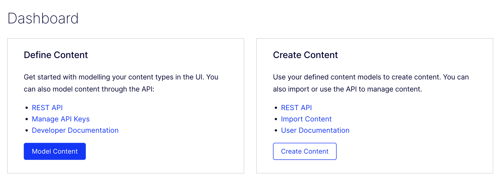
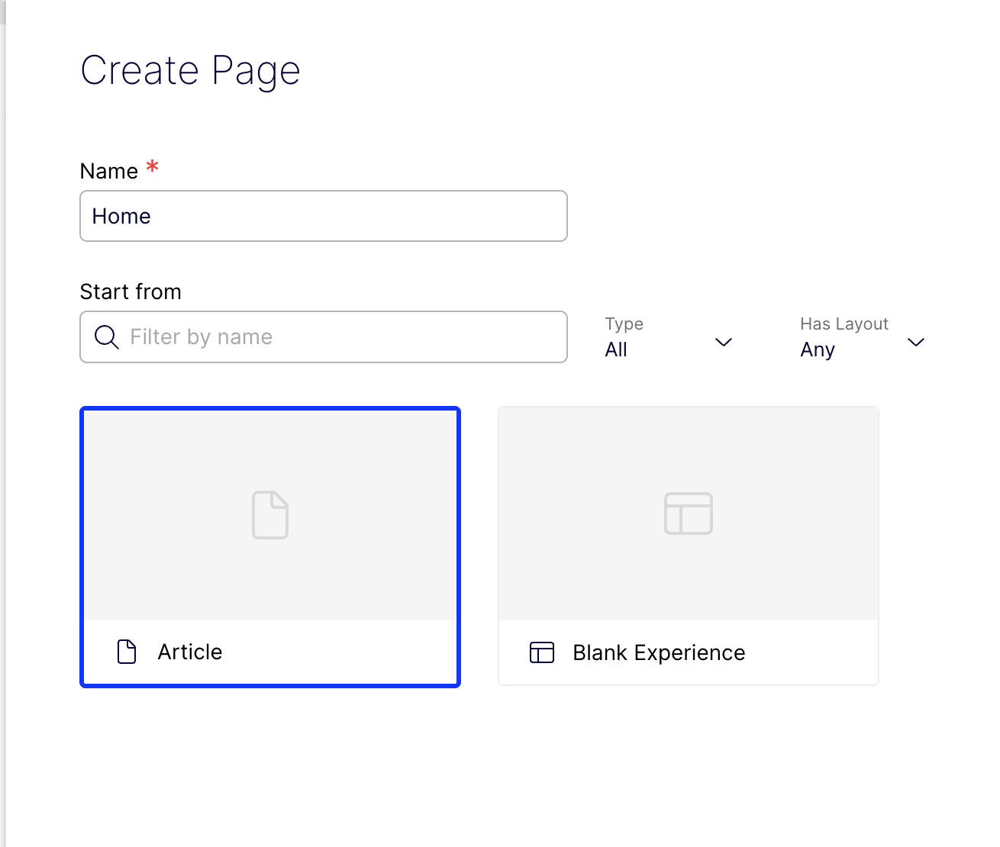
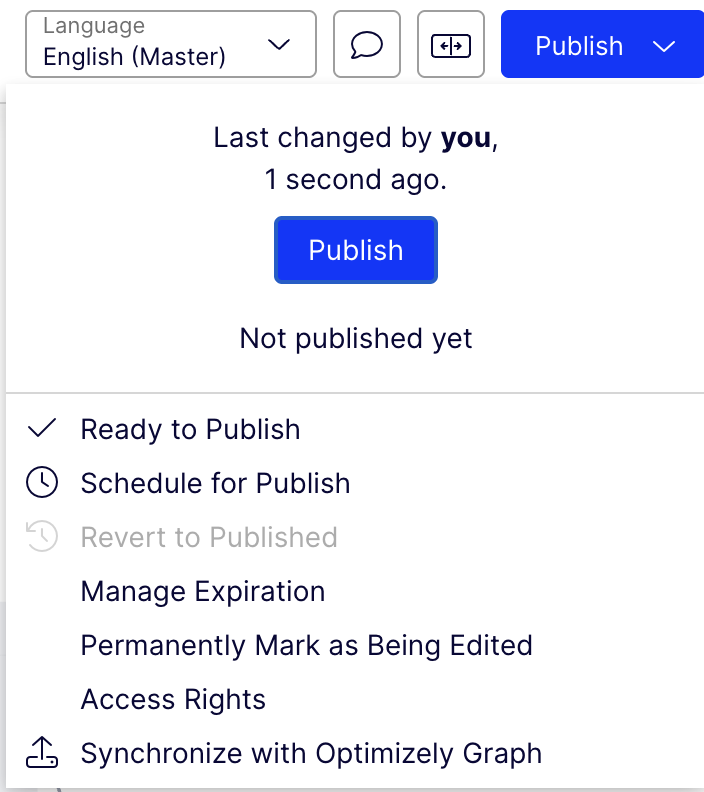
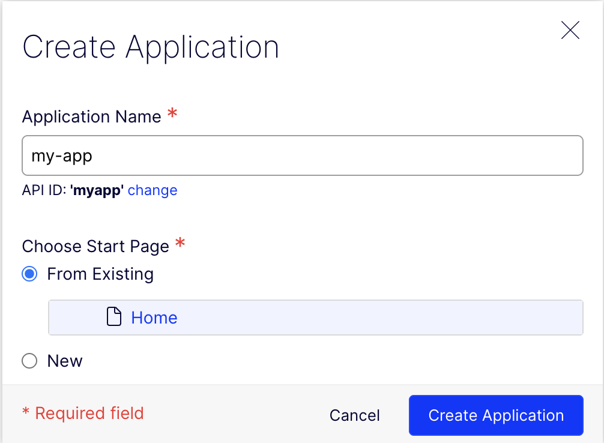

# Create content

With the `Article` content type in the CMS, you can write your first article. On this page
you create it, publish it and make it the start page of an application, so that it has a
URL your site can fetch.

> **You will learn**
>
> - How to create and publish an article
> - How to create an application
> - How to give the start page a clean URL

## Create and publish an article

1. In the CMS, click **Create Content**.

   

2. Enter **Home** as the name and choose **Article** as the content type.

   

3. Fill in the heading and the body.
4. Click **Publish → Publish Content**.

   

Only published content is returned to your site by default, so don't skip this step.

## Create an application

An **application** represents a site. It ties a start page to the domains the site runs
on.

1. Go to **Settings → Applications** and click **Create Application**.
2. Enter an **Application Name**, such as `my-app`. The API ID is generated for you.
3. Under start page, choose **From Existing → Home**.
4. Click **Create Application**.

   

> [!TIP]
>
> You can also create the start page and application from code, which is handy for setting
> up new environments. See
> [Creating a start page and an application](../reference/optimizely-config.md#creating-a-start-page-and-an-application).

## Give the start page a clean URL

The next page fetches the article by its URL, `/en/`. For that, the start page needs an
empty URL segment:

1. Go to **Content** and open **Home**.
2. Under **Name in URL**, click **Change** and clear the field.
3. Click **Publish → Publish Content**.

## Recap

- Create content from a content type with **Create Content**, then publish it.
- An application makes a page the start page of a site.
- Clearing the start page's **Name in URL** gives it the URL `/en/`.

**Next:** [Fetch content →](./fetch-content.md)
